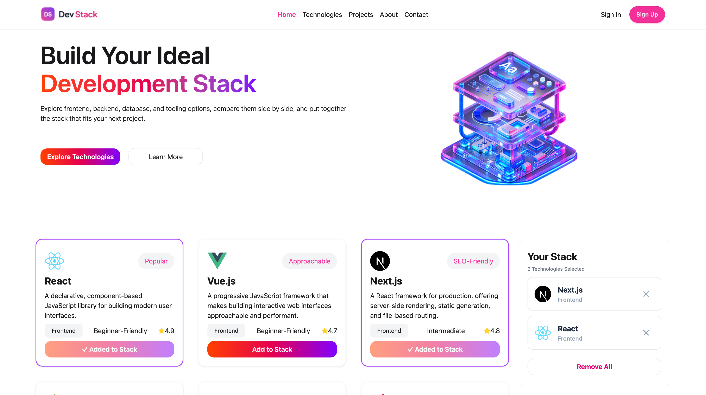

# Dev Stack

A simple website where developers can explore popular technologies and build their own tech stack.



---

## About

Dev Stack shows a list of technologies like React, Node.js, Docker and Git. You can read a short description of each one, then add your favourite ones to "Your Stack". I made this project to practice React and responsive design.

## Technologies Used

- **React** – for building the user interface
- **TypeScript** – for type safety
- **Vite** – for fast development
- **Tailwind CSS** – for styling
- **DaisyUI** – for ready-made buttons and components
- **React Toastify** – for popup messages
- **React Icons** – for icons

## Features

1. **Browse technologies** – see cards with name, category, level and rating.
2. **Build your own stack** – add or remove technologies, or remove all at once. A popup message shows each action.
3. **Responsive design** – the cards show in 3 columns on desktop, 2 on tablet and 1 on mobile. The stack panel moves below the cards on small screens.

## How to Run

```bash
git clone <your-repo-link>
cd a05-dev-stack
npm install
npm run dev
```

---

## React Questions

### 1. What is JSX, and why is it used in React?
JSX is a syntax that looks like HTML but is written inside JavaScript. It is used because it makes it easy to write the UI and JavaScript logic in the same place.

### 2. What is the difference between props and state?
Props are data that a parent gives to a child, and the child cannot change them. State is data inside a component that can change, and when it changes the component updates.

### 3. What does the useState hook do, and where did you use it in this project?
`useState` lets a component remember a value and re-render when the value changes. I used it in `Technologies.tsx` to keep the list of selected technologies (`inStack`), also in `Nav.tsx` to open and close the mobile menu (`menuOpen`).

### 4. What does the useEffect hook do, and why did you need it to load the JSON data?
`useEffect` runs code after the component renders, for example to fetch data. In this project I load `data.json` in `App.tsx` with `fetch`, and I read it with React's `use()` hook inside `<Suspense>`. This does the same job, so I did not need `useEffect`. If I used `useEffect`, I would call `fetch` inside it and save the result in state.

### 5. Why does every item in a .map() list need a unique key prop?
React uses the key to know which item is which. With a unique key, React updates only the changed item and does not mix up the list. I used `key={technology.id}` for each card.

### 6. What is conditional rendering? Show one place you used it.
Conditional rendering means showing something only when a condition is true. In `Nav.tsx`, the mobile menu shows only when `menuOpen` is true:

```jsx
{menuOpen && (
    <div className="md:hidden">
        <ul>...</ul>
    </div>
)}
```

I also use it in the stack panel to show the "Your Stack Is Empty" message when no technology is selected.

### 7. How do you pass data from a parent component to a child component, and how does a child send something back to the parent?
A parent passes data to a child with props. A child sends something back by calling a function that the parent passed as a prop. Example from my project:

```jsx
// Parent (Technologies.tsx)
<TechnologyCard
    Technology={technology}
    isInStack={...}
    onAdd={handleInStack}
/>
```

The card gets the data from props. When the user clicks "Add to Stack", the card calls `onAdd(technology)`, and the parent updates its state.

---

Made by **Siam** 💻
